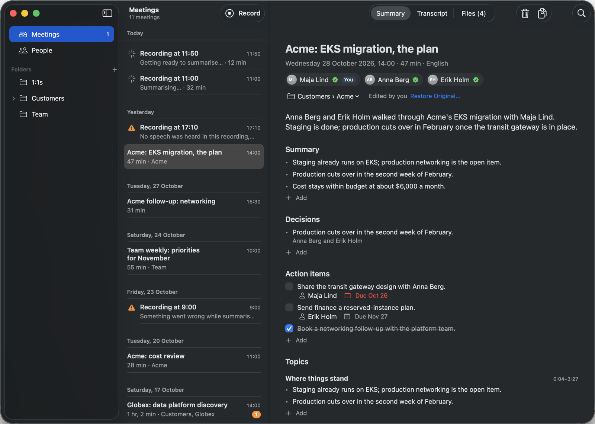
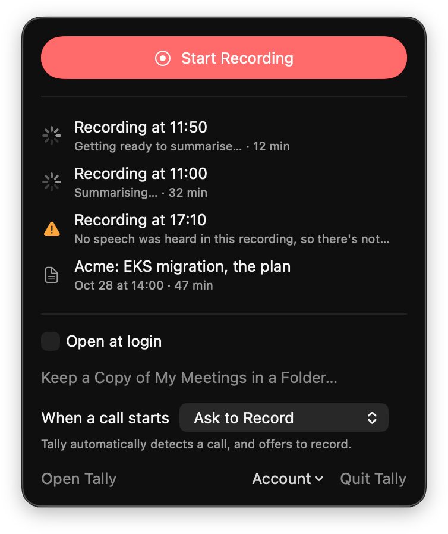
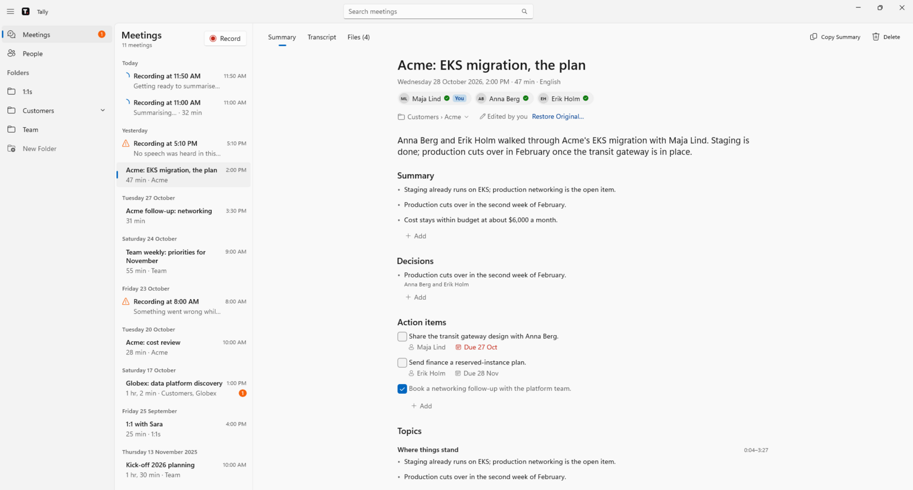

# Tally

Tally turns a meeting recording into a transcript with the speakers' real names, a summary you can read in 30 seconds, and action items.

Record on a Mac or Windows PC, in any call app or in a room; minutes later the summary is there. Confirm who spoke once, and Tally knows their voice from then on.

It runs in your own AWS account, for a person or a small team comfortable with AWS. Everyone signs in with their own account, and their meetings, people and voices are theirs alone.



<p>
  
  
</p>

**Cost:** about $0.16 of GPU for an hour-long meeting, scaling to zero between meetings, plus the model's tokens ([Costs](#costs)).

**Privacy:** recordings, transcripts and voiceprints stay in your AWS account; a model on Amazon Bedrock writes the summary. Tell people you're recording: in many places the law requires it.

To set up your own Tally:

1. [Ask for GPU quota](#what-you-need) and get a Hugging Face token.
2. [Fill in `config.json`](#configure).
3. [Deploy](#deploy): `make deploy`, `make image`, `make publish-site`.
4. Add people, and install the app from your site.

## How it works

The apps record the microphone and everything the computer plays, and upload it. A GPU job on AWS Batch transcribes it (Whisper), finds who spoke when (pyannote) and matches known voices. A Strands agent on Bedrock then names the speakers and writes the summary. One Lambda serves the API, and CloudFront the install page and an admin dashboard ([architecture](docs/architecture.md)).

## What you need

- **An AWS account and a region** with Batch, G-type GPU instances, and Bedrock access to the model in `modelId`.
- **GPU quota, asked for first,** since it can take a day: at least 32 vCPUs of "Running On-Demand G and VT instances" in Service Quotas (Batch may launch a g6.8xlarge when smaller types have no capacity).
- **A Hugging Face token.** Accept the terms of [pyannote/speaker-diarization-community-1](https://huggingface.co/pyannote/speaker-diarization-community-1), make a read token, and store it under the name in `hfTokenSecret`:
  ```
  aws secretsmanager create-secret --name tally/hf-token --secret-string "<token>" --region <region>
  ```
- **To deploy:** a Mac or Linux machine with git 2.37 or newer, `jq`, `curl`, `shasum`, `uv`, Node.js and the AWS CLI. No Docker: CodeBuild builds the pipeline's image.

## Configure

```
cp config.example.json config.json
```

`config.json` is gitignored.

Every setting is in the example. The optional ones are off there (`null`, `false` or `{}`); fill one in to use it.

| Setting | Required | What it is |
|---|---|---|
| `account`, `region` | Yes | Where the stack goes |
| `stackName` | Yes | The stack's name |
| `timezone` | Yes | For warm hours and the dashboard's "today" |
| `domain` | No | The site's own domain in Route 53, `{"name": "tally.example.com", "hostedZoneId": "Z0123456789ABCDEFGHIJ"}`. Without it, the site is at its CloudFront address |
| `auth` | No | Your OIDC provider, `{"name", "issuer", "clientId", "adminClaim"}` (below). Without it, the stack makes a Cognito user pool |
| `bundleId` | Yes | The Mac app's bundle id. Keep it once people use the app: macOS ties permissions and the saved sign-in to it |
| `modelId` | Yes | The Bedrock model, as a cross-region inference profile |
| `modelPrices` | Yes | Dollars per million tokens, for the dashboard ("standard" rates for an `eu.` or `us.` profile, "global" for `global.`) |
| `hfTokenSecret` | Yes | The Secrets Manager name of the Hugging Face token |
| `sharedVoices` | No | `true` to match voices across everyone in your deployment (below) |
| `crashEmail` | No | Who gets an email when an app sends a crash report, `"you@example.com"` |
| `gpu` | Yes | `instanceTypes` (single-GPU types Batch may launch) and `maxVcpus`; optional `warm` (below) |
| `tags` | No | Tags on everything, beside `project=tally`, `{"team": "ops"}` |

**Another region than eu-north-1:** change `region`, `modelId`'s prefix, `modelPrices`, `timezone` and `gpu.instanceTypes` (`aws ec2 describe-instance-type-offerings --region <region>` lists a region's types).

**`gpu.warm`** keeps a GPU running, so a meeting starts within seconds instead of after a 6–7 minute cold start. `{"vcpus": 4}` keeps one always on; `{"vcpus": 4, "from": 7, "to": 21}` keeps one from 07:00 to 21:00.

**`sharedVoices`** also suggests matches among the people everyone else in your deployment has named. It shares biometric data of people who never used Tally: be sure you have a legal basis (in the EU, GDPR) and that your users know.

**Your own OIDC provider:** set `auth` to `name` (as in "Sign In to `<name>`"), `issuer`, `clientId` and `adminClaim`, the dotted path of the claim listing a person's roles (`resource_access.tally.roles` in Keycloak); `admin` there opens the dashboard. The client must be public, with authorization code and PKCE S256, redirects to `tally://callback` and `https://<site>/admin.html`, and the web origin `https://<site>`. Access tokens must have the client as `aud`, and a `sub` of letters, digits, `-` and `_`.

## Deploy

Bootstrap CDK once per account and region (us-east-1 is for a `domain`'s certificate), then deploy:
```
cd cdk && npx -y aws-cdk@latest bootstrap aws://<account>/<region> aws://<account>/us-east-1 && cd ..
make deploy        # the stacks
make image         # start building the pipeline's image in CodeBuild (about 15 minutes)
make publish-site  # the install page, both install scripts, the admin dashboard and both apps' source
```

**With Cognito**, add people yourself; those in the `admin` group see the dashboard. The pool's id is the end of the stack's `Issuer` output:
```
aws cognito-idp admin-create-user --user-pool-id <pool> --username someone@example.com \
  --user-attributes Name=email,Value=someone@example.com Name=email_verified,Value=true --region <region>
aws cognito-idp admin-add-user-to-group --user-pool-id <pool> --username someone@example.com --group-name admin --region <region>
```

**Installing the apps:** open the site (the stack's `SiteUrl` output) and run its command: `curl -fsSL https://<site>/install.sh | bash` on a Mac, `irm https://<site>/install.ps1 | iex` in Windows PowerShell. It builds Tally on that computer, and the app offers each new version. The dashboard is `https://<site>/admin.html`.

**Cost tracking** needs Cost Explorer turned on (in the Billing console), and the `project=tally` tag activated a day after the first deploy (from the management account, in an AWS Organization):
```
aws ce update-cost-allocation-tags-status --cost-allocation-tags-status TagKey=project,Status=Active
```

## Update

```
git pull
cd cdk && npx -y aws-cdk@latest diff --all && cd ..
make deploy && make image && make publish-site
```

The diff must show no replacement or removal of the data bucket, the tables, the KMS key, the API or its authorizer. `make publish-site` needs `apps/mac/`, `apps/windows/` and `site/` committed, since each app's version is its commit.

With warm hours, a deploy that changes the GPU launch template resets the warm minimum to 0 until the next schedule. During warm hours, set it back on the `OnDemand…` environment:
```
aws batch update-compute-environment --compute-environment <environment> --compute-resources minvCpus=<gpu.warm.vcpus> --region <region>
```

## Remove

`cd cdk && npx -y aws-cdk@latest destroy --all` removes the stacks but keeps the data bucket, tables, KMS key, site bucket, image repository, Cognito pool and logs, so no meeting is lost by accident. Delete those by hand.

## Costs

Measured on the maintainer's deployment in eu-north-1:
- **GPU:** about $0.16 for an hour-long meeting on a g6.xlarge: 11 minutes of instance time, 7 of them the cold start.
- **A warm instance** (Batch picks a g6.4xlarge): about $590 a month from 07:00 to 21:00, $1,025 always on.
- **The model's tokens** are priced on the dashboard. The rest is small.

## Limitations

- English and Swedish only.
- A recording stops at 4 hours.
- Sign-in is tested with Keycloak and Cognito; Okta and Entra ID need scopes Tally doesn't ask for yet.
- Windows' Smart App Control and organisations' app control block Tally, since it's built on the PC and unsigned ([troubleshooting](docs/troubleshooting.md#smart-app-control-or-app-control-blocks-tally)).
- On a Mac, the keychain asks once after each install whether Tally may read its sign-in.

## Develop

The Mac app builds on macOS 26 with the Command Line Tools, the Windows app on Windows 11 with the .NET 10 SDK.

```
make test          # the pipeline's and the API's tests; no AWS
make app-test      # the Mac app's tests
make windows-test  # the Windows app's Core tests, on any OS
make signing-cert  # once per Mac: the "Tally Local" certificate
make install       # build the Mac app with the deployed stack's settings, and install it
```

The details are in [docs/](docs/), and the evals in [evals/](evals/README.md).

## Contributing

Issues and pull requests are welcome: see [CONTRIBUTING.md](CONTRIBUTING.md), and report vulnerabilities privately ([SECURITY.md](SECURITY.md)).

## Licence

Source-available under [PolyForm Shield 1.0.0](LICENSE.md): use, change and share Tally, at work too, but not to offer a competing product. The models have their own licences ([NOTICE.md](NOTICE.md)).
